


 

Tengo 17 años y me gusta construir cosas de punta a punta: desde la base de datos hasta la pantalla que ves. Hoy soy **full stack**; hacia donde voy es **product engineering**: entender qué necesita la gente y convertirlo en un producto que funcione y se vea bien.

 

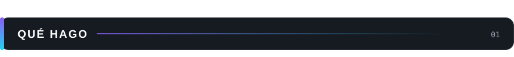

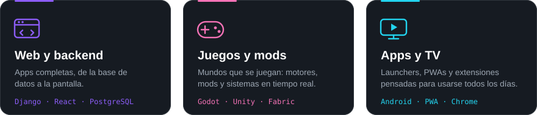

 

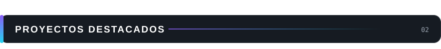

<a href="https://github.com/Justin-Ocana/LightCode-Core">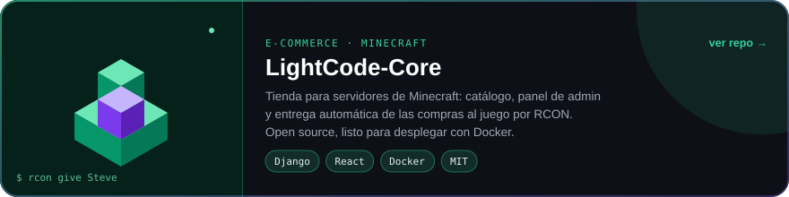</a>
<a href="https://github.com/Justin-Ocana/aurora-tv">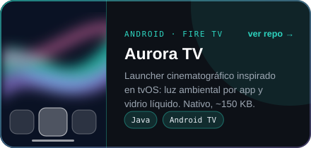</a>
<a href="https://github.com/Justin-Ocana/cn-recreations">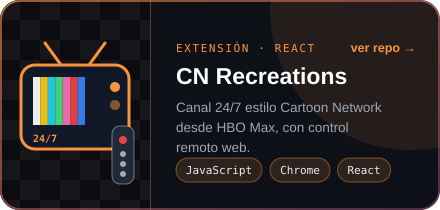</a>
<a href="https://github.com/Justin-Ocana/lemon-pos">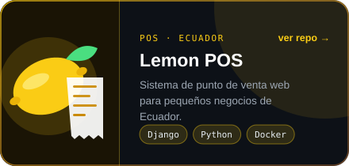</a>
<a href="https://github.com/Justin-Ocana/academic-task-manager">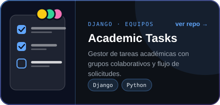</a>

 

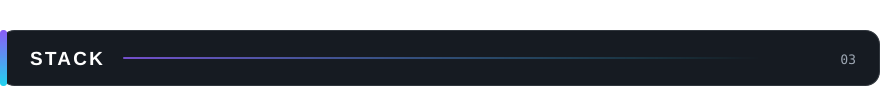

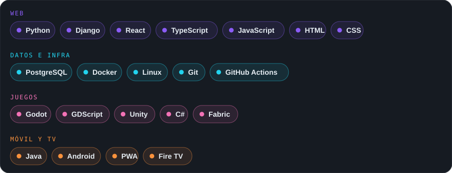

 

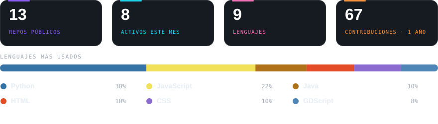

<picture>
  <source media="(prefers-color-scheme: dark)" srcset="https://raw.githubusercontent.com/Justin-Ocana/Justin-Ocana/output/github-contribution-grid-snake-dark.svg" />
  
</picture>

 

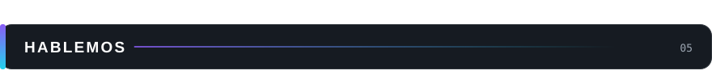

<a href="https://github.com/Justin-Ocana">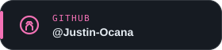</a>

  

